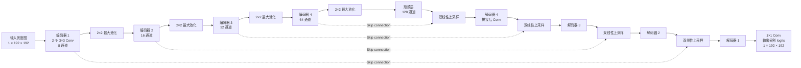
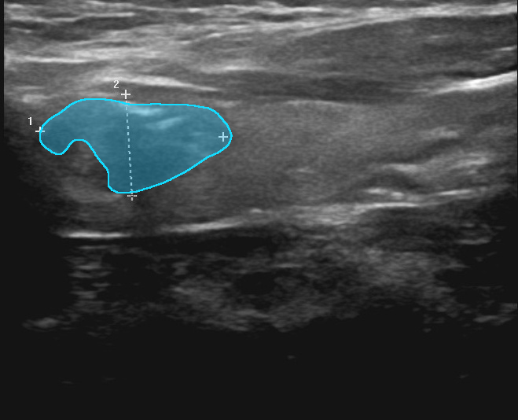

# 甲状腺超声 CNN 实战项目

这是一个可直接在 VS Code 中运行的课程项目：使用轻量 U-Net（CNN）自动分割甲状腺超声图中的结节区域。

## 基础知识：CNN 与 U-Net 的关系

### CNN 是什么

CNN（卷积神经网络）通过卷积核在图像上滑动，学习边缘、纹理和形状等局部特征。一个典型的图像 CNN 通常由以下部分组成：

- 卷积层：使用例如 `3×3` 的卷积核提取局部特征；
- 激活函数：本项目使用 ReLU 增加非线性表达能力；
- 池化或下采样：减少空间尺寸、扩大感受野；
- 全连接层或输出卷积：将特征转换为任务所需的输出。

### U-Net 是什么

U-Net 不是与 CNN 并列的另一类模型，而是一种专门面向图像分割的 CNN 结构。它把 CNN 的卷积操作组织成“编码器—解码器”两条路径：

1. 编码器逐步下采样，学习从低级边缘到高级语义的特征；
2. 解码器逐步上采样，把特征恢复到原图分辨率；
3. Skip connection 将编码器的高分辨率细节直接传给解码器，帮助恢复结节边界。

因此，本项目的关系可以简单理解为：

> CNN 是基础技术，U-Net 是利用卷积层、池化、上采样和跳跃连接组织起来的分割网络；本项目使用 U-Net 这个 CNN 来完成像素级结节分割。

### 本项目的 U-Net 结构示意图




本项目中的具体参数为：每个卷积块包含两次 `3×3` 卷积、BatchNorm 和 ReLU；编码器通道数为 `8 → 16 → 32 → 64 → 128`；解码器使用双线性上采样；最后用 `1×1` 卷积输出一个前景通道。训练时输出是 logits，预测时经过 sigmoid 后以 `0.5` 为阈值生成 mask。

## 目录怎么找

- `main.py`：唯一主入口。
- `data/raw/TN3K`：完整数据集，图像和对应 mask。
- `data/processed`：运行 `prepare` 后生成的缓存数据。
- `src`：数据处理、U-Net、训练、评价和预测代码。
- `models`：模型权重；已放入一份已训练好的 C 组权重。
- `results`：训练日志、测试指标和预测图片。
- `run_*.bat`：Windows 快速运行入口。

## 在 VS Code 中运行

建议使用已验证的 Python 环境：`D:\Anaconda\envs\pytorch_learning\python.exe`。

```powershell
python main.py prepare
python main.py evaluate --experiment C
python main.py predict --image data/raw/TN3K/test-image/0000.jpg
```

已有权重时，前两条命令可以直接查看结果；预测图会写入 `results/predictions`。

从头训练 C 组：

```powershell
python main.py train --experiment C --epochs 30
```

快速检查代码和显卡：

```powershell
python main.py train --experiment C --epochs 1 --limit 16
```

三组设置：A 是基础 BCE，B 增加数据增强，C 在 B 上增加 Dice 损失。训练结束后权重写入 `models`，逐轮记录写入 `results`。

## 数据说明

TN3K 已经完整放入 `data/raw/TN3K`，包含 3493 张图像和 3493 张对应 mask。`data/raw/tn3k-trainval-fold0.json` 保存训练/验证划分。运行 `prepare` 后，程序会保持原始图像比例缩放到 192×192，并排除补边区域的损失与评价。生成的 `data/processed` 缓存被忽略，避免把可重建的二进制缓存重复上传。

## 实验结果

本项目使用 TN3K 的固定训练/验证/测试划分，测试集共 614 张图像，输入统一缩放到 `192×192`，预测阈值为 `0.5`。下面的结果来自 `results/reference_run/comparison.json` 和 `results/evaluation_C/summary.json`。

| 实验 | 设置 | 最佳轮次 | 验证集 Dice | 测试集 Dice | IoU | Recall | Precision | Pixel Accuracy |
|---|---|---:|---:|---:|---:|---:|---:|---:|
| A | 基础 BCE | 16 | 0.6928 | 0.6962 | 0.5915 | 0.7744 | 0.7077 | 0.9545 |
| B | BCE + 数据增强 | 30 | 0.7436 | 0.7542 | 0.6536 | 0.7848 | 0.7967 | 0.9639 |
| C | BCE + 数据增强 + Dice | 28 | **0.7685** | **0.7845** | **0.6842** | **0.8453** | 0.7900 | **0.9647** |

### 结果解读

- 在本次实验中，B 相比 A 的测试 Dice 从 `0.6962` 提升到 `0.7542`，说明数据增强提高了模型的泛化表现。
- C 在 B 的基础上加入 Dice 损失，测试 Dice 进一步达到 `0.7845`，同时 Recall 达到 `0.8453`，对结节区域的覆盖更充分。
- Pixel Accuracy 较高并不等于分割一定准确，因为背景像素通常占比较大，所以本项目同时报告 Dice、IoU、Recall 和 Precision。
- 以上结果是课程实验数据集上的模型表现，不应直接解释为临床诊断能力；还需要更多独立数据和医学验证。

### 已生成的可视化结果

预测叠加示例位于 `results/predictions`：



详细的逐图指标见 `results/evaluation_C/per_image.csv`，整体汇总见 `results/evaluation_C/summary.json`。

### 实验记录文件索引

- `results/reference_run/comparison.md`：排版后的实验记录页面，建议老师优先阅读；
- `results/reference_run/comparison_chart.svg`：A/B/C 的 Dice、IoU 指标对比图；
- `results/reference_run/comparison.csv`：A、B、C 三组实验的汇总表；
- `results/reference_run/comparison.json`：同一汇总结果的 JSON 格式；
- `results/reference_run/test_summary.json`：最终选中的 C 组模型摘要；
- `results/evaluation_C/per_image.csv`：C 组测试集逐图指标。


## 参考文献

[1] Ronneberger O, Fischer P, Brox T. U-Net: Convolutional Networks for Biomedical Image Segmentation. MICCAI, 2015. https://arxiv.org/abs/1505.04597

[2] Gong H, et al. Multi-Task Learning For Thyroid Nodule Segmentation With Thyroid Region Prior. ISBI, 2021, 257-261. DOI: 10.1109/ISBI48211.2021.9434087. Author repository: https://github.com/haifangong/TRFE-Net-for-thyroid-nodule-segmentation

[3] TN3K thyroid nodule segmentation dataset. Fixed revision: `c0479e921fc9b7afcf1e8ca9b296a408e06a5bb9`, accessed 2026-11-16. https://huggingface.co/datasets/haifan-gong/TN3K
