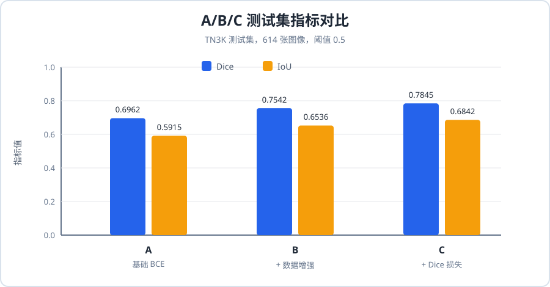

# 实验记录：A/B/C 三组设置对比

这份页面是给人阅读的实验摘要；原始机器可读记录仍保留在同目录的 `comparison.csv` 和 `comparison.json` 中。

## 实验条件

- 数据集：TN3K
- 测试集：614 张图像
- 输入尺寸：`192 × 192`
- 预测阈值：`0.5`
- 模型选择规则：只使用验证集 Dice 选择最佳权重，测试集只用于最终报告
- 训练轮数：30 个 epoch

## 一眼看结果

| 实验 | 主要设置 | 最佳轮次 | 验证集 Dice | 测试集 Dice | IoU | Recall | Precision | Pixel Accuracy |
|---|---|---:|---:|---:|---:|---:|---:|---:|
| A | 基础 BCE | 16 | 0.6928 | 0.6962 | 0.5915 | 0.7744 | 0.7077 | 0.9545 |
| B | BCE + 数据增强 | 30 | 0.7436 | 0.7542 | 0.6536 | 0.7848 | 0.7967 | 0.9639 |
| C | BCE + 数据增强 + Dice | 28 | **0.7685** | **0.7845** | **0.6842** | **0.8453** | 0.7900 | **0.9647** |

## 结果说明

- B 相比 A 的测试 Dice 提升 `0.0580`，说明在本次划分上数据增强带来了更好的泛化表现。
- C 相比 B 的测试 Dice 进一步提升 `0.0302`；Recall 从 `0.7848` 提升到 `0.8453`，说明加入 Dice 损失后对结节区域的覆盖更充分。
- C 组的验证集 Dice 最高，因此最终模型选择 C，而不是根据测试集结果反向选择模型。
- Pixel Accuracy 受大量背景像素影响，不能单独代表分割质量，因此同时报告 Dice、IoU、Recall 和 Precision。

## 指标含义

| 指标 | 含义 |
|---|---|
| Dice | 预测区域与人工标注的重叠程度，越接近 1 越好 |
| IoU | 交并比，衡量预测区域和标注区域的交集/并集 |
| Recall | 标注为结节的像素中被找回的比例 |
| Precision | 预测为结节的像素中真正属于结节的比例 |
| Pixel Accuracy | 有效区域内预测正确的像素比例 |

## 相关文件

- `comparison.csv`：完整汇总表，便于程序读取；
- `comparison.json`：同一结果的 JSON 版本；
- `test_summary.json`：C 组最终模型摘要；
- `../evaluation_C/per_image.csv`：C 组 614 张测试图像的逐图指标；
- `../../models/best_model.pt`：C 组最佳模型权重。
